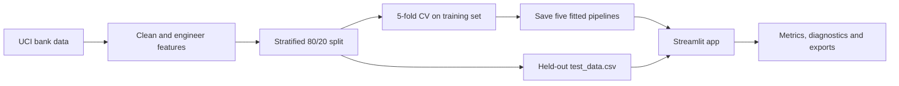

# Term Deposit Predictor - Machine Learning Assignment II

End-to-end classification project: five ML models trained on the UCI Bank Marketing dataset (41,188 records), evaluated on a held-out test set, and served through an interactive Streamlit app.

- **Submitted by:** Sabareeshwaran K
- **BITS ID:** 2026AJ05033
- **Programme:** M.Tech (Artificial Intelligence and Machine Learning), BITS Pilani WILP
- **GitHub repository:** https://github.com/2026aj05033-collab/bank-marketing-classifier
- **Live Streamlit app:** https://bank-marketing-classifier-2026aj05033.streamlit.app/

## Project summary

| Item | Implementation |
|---|---|
| Task | Binary classification of term-deposit subscription (`yes` / `no`) |
| Dataset | UCI Bank Marketing, 41,188 records |
| Input features | 19 raw features; call `duration` excluded to prevent leakage |
| Models | Logistic Regression, Decision Tree, KNN, Gaussian Naive Bayes, Linear SVM |
| Evaluation | Accuracy, AUC, Precision, Recall, F1 and MCC |
| Validation | Stratified 80/20 hold-out split; 5-fold stratified CV for tuning |
| Deployment | Public Streamlit Community Cloud app loading saved pipelines only |

---

## a. Problem statement

A Portuguese bank runs phone-based marketing campaigns to sell term deposits. Most calls fail: only about 1 in 9 clients subscribes. The goal is to predict, **before making the call**, whether a client will subscribe to a term deposit (`y` = yes/no), using their profile, previous campaign history and the economic conditions at the time. This is a **binary classification** problem. A good model lets the bank prioritise the clients most likely to say yes, cutting call-centre cost.

## b. Dataset description

| Item | Detail |
|---|---|
| Name | Bank Marketing — `bank-additional-full` |
| Source | UCI Machine Learning Repository — https://archive.ics.uci.edu/dataset/222/bank+marketing (also on Kaggle) |
| Instances | **41,188** phone-call records (May 2008 – Nov 2010) |
| Features | 20 in the original file; **19 used** (see note on `duration`) |
| Target | `y` — subscribed to a term deposit: yes (4,640 / 11.3%) vs no (36,548 / 88.7%) — highly imbalanced |
| Missing values | No nulls, but several categorical columns use `"unknown"` (e.g. `default` 8,597, `education` 1,731), which is kept as its own category |

**Features used (19)**

| Group | Columns |
|---|---|
| Client profile | `age`, `job`, `marital`, `education`, `default`, `housing`, `loan` |
| Current campaign contact | `contact`, `month`, `day_of_week`, `campaign` (number of calls in this campaign) |
| Previous campaign | `pdays` (days since last contact, 999 = never), `previous`, `poutcome` |
| Economic context | `emp_var_rate`, `cons_price_idx`, `cons_conf_idx`, `euribor3m`, `nr_employed` |

**Note on `duration`.** The dataset authors warn that `duration` (the length of the call) strongly affects the target but is only known *after* the call ends; a call of 0 seconds always means "no". Including it would leak the answer and give unrealistically high scores, so it is excluded.

**Engineered features** (added inside the pipeline, see `preprocess.py`)

- `prev_contacted` — yes/no flag derived from `pdays != 999`
- `days_since_prev` — `pdays` with the 999 sentinel replaced by −1, so scaling is not distorted
- `loan_burden` — number of existing loans (housing + personal, 0–2)
- `age_group` — age bucketed into ≤25, 26–35, 36–45, 46–60, 60+

**Preprocessing:** imputation (safety net) → `StandardScaler` for numeric columns → `OneHotEncoder` for categorical columns. Data split 80/20 (stratified, `random_state=42`): **32,950 training rows, 8,238 test rows** (`test_data.csv`). Hyper-parameters were tuned with 5-fold stratified cross-validation on the training split only, optimising F1 because of the class imbalance.

### End-to-end workflow



## c. GitHub repository

https://github.com/2026aj05033-collab/bank-marketing-classifier

```
bank-marketing-classifier/
├── app.py                     # Streamlit application
├── preprocess.py              # shared feature engineering + preprocessing pipeline
├── requirements.txt
├── README.md
├── test_data.csv              # held-out 20% test split (19 features + y)
├── data/
│   └── bank_marketing.csv     # full dataset (41,188 rows)
├── model/
│   ├── train_models.py        # trains, tunes, evaluates and saves all 5 models
│   ├── logistic_regression.joblib
│   ├── decision_tree.joblib
│   ├── knn.joblib
│   ├── naive_bayes.joblib
│   ├── svm.joblib
│   ├── metrics.json           # test metrics + tuned hyper-parameters
│   └── metrics_table.md
└── .streamlit/config.toml     # app theme
```

## d. Models used

All five models are scikit-learn pipelines (preprocessing + classifier) trained on the same data:

| Model | Tuned hyper-parameters |
|---|---|
| Logistic Regression | C = 1.0, class_weight = balanced |
| Decision Tree | max_depth = 5, min_samples_leaf = 20, class_weight = balanced |
| K-Nearest Neighbors | n_neighbors = 11, weights = uniform |
| Naive Bayes (Gaussian) | var_smoothing = 0.01 |
| Support Vector Machine | Linear SVM (`LinearSVC`), C = 0.01, no class weighting; probabilities via `CalibratedClassifierCV` |

### Evaluation metrics

| Metric | What it measures | Why it matters here |
|---|---|---|
| Accuracy | Share of all predictions that are correct | Included for completeness, but inflated by the majority `no` class |
| AUC | Ranking quality across all classification thresholds | Measures how well a model prioritises likely subscribers |
| Precision | Correct subscriptions among predicted subscriptions | Indicates how many targeted calls are likely to succeed |
| Recall | Correctly detected subscribers among all actual subscribers | Indicates how many potential subscribers are found |
| F1 | Harmonic mean of precision and recall | Balances the two positive-class objectives |
| MCC | Correlation between actual and predicted classes | Robust single score for the strongly imbalanced target |

### Comparison table (test set, 8,238 rows)

| ML Model Name | Accuracy | AUC | Precision | Recall | F1 | MCC |
|---|---|---|---|---|---|---|
| Logistic Regression | 0.8248 | 0.7934 | 0.3468 | 0.6282 | 0.4469 | 0.3750 |
| Decision Tree | 0.8381 | 0.7757 | 0.3650 | 0.5916 | 0.4515 | 0.3772 |
| KNN | 0.8943 | 0.7415 | 0.5704 | 0.2489 | 0.3466 | 0.3292 |
| Naive Bayes | 0.8665 | 0.7750 | 0.4137 | 0.4440 | 0.4283 | 0.3531 |
| Support Vector Machine | 0.8977 | 0.7919 | 0.6592 | 0.1897 | 0.2946 | 0.3164 |

*Precision, Recall and F1 are for the positive class (`y` = yes). A model that always predicts "no" would already reach 0.887 accuracy, so accuracy alone is misleading here; AUC, F1 and MCC are the meaningful metrics.*

### Observations

| ML Model Name | Observation about model performance |
|---|---|
| Logistic Regression | Highest AUC (0.793), so it ranks clients by likelihood to subscribe better than any other model. CV chose `class_weight="balanced"`, which pushes recall up to 0.628 (it finds ~63% of subscribers) at the cost of precision (0.347) and accuracy (0.825). The economic indicators (`euribor3m`, `nr_employed`) and previous success (`poutcome`) act almost linearly, which suits this model. MCC 0.375 is essentially tied for best. |
| Decision Tree | Best F1 (0.452) and best MCC (0.377). A shallow tree (depth 5, balanced weights) works well because the data has a few strong threshold-type splits, e.g. low `nr_employed` / `euribor3m` periods and `poutcome = success`. Its AUC (0.776) is lower than LR because a depth-5 tree gives only a few distinct probability values, so its ranking is coarse. It is also the easiest model to explain to the marketing team. |
| KNN | High accuracy (0.894) but this mostly reflects predicting "no": recall is only 0.249. KNN has no class weighting, so in neighbourhoods dominated by the 89% majority class the minority "yes" rarely wins the vote. Lowest AUC (0.741), because distances in a space with 70 columns after one-hot encoding are not very informative. It is also the slowest model at prediction time and the largest file (stores all training rows). |
| Naive Bayes | A middle-ground model: precision 0.414 and recall 0.444 are balanced, giving F1 0.428 and MCC 0.353. It trains in seconds. Its independence assumption is clearly broken: the five economic indicators are strongly correlated with each other (e.g. `euribor3m` and `nr_employed`), so the same signal is counted several times, which limits its AUC (0.775). |
| Support Vector Machine | Highest accuracy (0.898) and highest precision (0.659): when it says "yes" it is right two-thirds of the time. But CV picked a strongly regularised model without class weights, so it predicts "yes" very rarely and has the lowest recall (0.190), F1 (0.295) and MCC (0.316). Its AUC (0.792) is almost equal to LR's, which shows the ranking is good and a lower decision threshold would recover much more recall. The linear kernel was used because an RBF SVM on 33k rows is very slow to train and tune. |
| **Overall** | No single model wins every metric, which is typical for an imbalanced problem. **Decision Tree** (best F1 and MCC) and **Logistic Regression** (best AUC, near-equal MCC) are the strongest. Logistic Regression is the most practical choice: its well-ranked probabilities let the bank call clients in order of likelihood and choose its own threshold. High-accuracy models like KNN and SVM are misleading here because they mostly predict the majority class. |

## Streamlit app features

- **CSV upload** of test data, a bundled sample-data toggle and sample CSV download
- **Model selection dropdown** for the five classifiers
- **Evaluation metrics:** Accuracy, AUC, Precision, Recall, F1, MCC
- **Confusion matrix**, **ROC curve**, **precision-recall curve** and **classification report**
- **Compare all models** view with ranking controls, leaderboard, heat map and head-to-head chart
- **Test-data inspection** with schema checks, class balance and feature summaries
- **Light and dark themes** with a responsive desktop/mobile layout
- Downloads for the sample data, per-row predictions and model comparison table

The app only loads the saved `.joblib` pipelines and calls `predict` / `predict_proba`; it never retrains on uploaded data.

### Test CSV contract

An uploaded CSV must contain all 19 columns listed under **Features used**, plus the target column `y`. The target accepts `yes`/`no` or `1`/`0`. Column names are normalised by replacing dots with underscores. Extra columns, including `duration`, are ignored. Unknown categorical values are accepted by the fitted one-hot encoder.

### Using the live app

1. Open the [deployed Streamlit application](https://bank-marketing-classifier-2026aj05033.streamlit.app/).
2. Keep **Use bundled test_data.csv** enabled for the supplied hold-out set, or upload another compatible test CSV.
3. Select a classifier in the sidebar.
4. Select the ranking metric, with MCC recommended for this imbalanced dataset.
5. Review the selected-model diagnostics or compare all five models.
6. Download row-level predictions or the comparison table when required.

## How to run locally

```bash
pip install -r requirements.txt
python model/train_models.py   # optional: retrains and regenerates model/ and test_data.csv (~1 min)
streamlit run app.py
```

> Saved `.joblib` models must be loaded with the same scikit-learn version they were trained with. If you retrain with a different version, update the `scikit-learn==` line in `requirements.txt` to match.

## Reproducibility and deployment

- Package versions are pinned in `requirements.txt`, including the scikit-learn version used by the saved pipelines.
- `random_state=42` is used for the train/test split, cross-validation and applicable estimators.
- Every model receives the same training and held-out test rows.
- Preprocessing is stored inside each fitted pipeline, so training and inference use identical transformations.
- The app is deployed from the public `main` branch. Commits pushed to `main` trigger a Community Cloud redeployment.
- Streamlit Community Cloud may briefly wake an inactive free-tier app on first access. Refreshing the same public URL starts it automatically.

## Assignment requirement checklist

| Instructor requirement | Status | Evidence |
|---|---|---|
| Public classification dataset with at least 12 features and 500 instances | Complete | UCI dataset, 19 used features, 41,188 records |
| Five required classifiers | Complete | Five saved pipelines under `model/` |
| Accuracy, AUC, Precision, Recall, F1 and MCC | Complete | README table, `metrics.json` and live app |
| Experimental test CSV | Complete | `test_data.csv`, 8,238 held-out rows |
| Model selection dropdown | Complete | Sidebar classifier control |
| Test CSV upload | Complete | Sidebar CSV uploader |
| Confusion matrix or classification report | Complete | Both are included |
| Saved-model inference without retraining | Complete | `joblib.load`, `predict` and `predict_proba` only |
| Public GitHub repository | Complete | Linked at the top of this README |
| Public Streamlit application | Complete | Linked at the top of this README |

## Repository contents

- `app.py` - interactive Streamlit evaluation dashboard
- `preprocess.py` - shared cleaning, feature engineering and preprocessing pipeline
- `model/train_models.py` - training, tuning, evaluation and artifact generation
- `model/*.joblib` - five fitted scikit-learn pipelines
- `model/metrics.json` - full-precision held-out metrics and tuned parameters
- `model/metrics_table.md` - generated model-comparison table
- `test_data.csv` - held-out experimental test set used by the app
- `data/bank_marketing.csv` - complete source dataset
- `.streamlit/config.toml` - Streamlit theme configuration
- `requirements.txt` - pinned runtime dependencies
